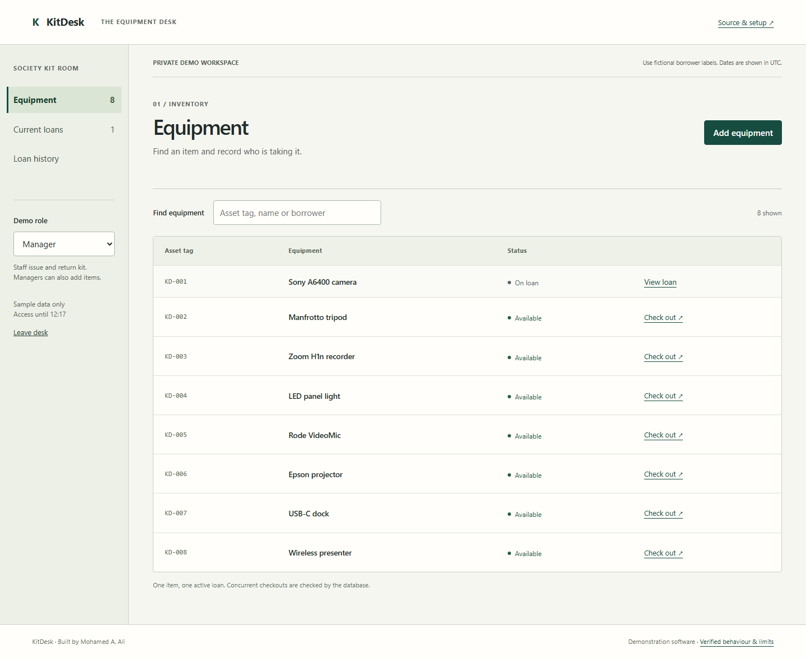

# KitDesk

An equipment-lending desk built with **C#, ASP.NET Core 10, Entity Framework Core, React and PostgreSQL**.
Issue an item, record its return and keep the original loan history.

[Run locally](#run-locally) · [Verification](docs/verification.md) · [Deployment](docs/deployment.md) · [Workflow recording](docs/recordings/lending-workflow.webm)

**Verified against real PostgreSQL:** eight simultaneous checkout requests produced one successful loan and seven conflicts. The database enforces one active loan per item.

The hosted demonstration is being prepared. Each visitor gets an isolated temporary workspace backed by the same .NET API and PostgreSQL database used by the tests.



## Try the workflow

1. Open a demo desk. Each visitor receives separate sample equipment and two sample operators.
2. As manager, add an item. Switch to staff: adding equipment is no longer permitted by the API.
3. Check out an available item to a fictional borrower label. Inspect it in **Current loans**.
4. Record the return and inspect **Loan history**. The original checkout remains unchanged.
5. In two tabs of the same workspace, open checkout forms for one item. Submit both: one succeeds; the other keeps the entered form and explains the conflict.

Access lasts one hour. Expired workspaces, equipment, loans and demo accounts are deleted when a later visitor starts a demo. Expiry blocks access before cleanup runs. Use fictional labels only.

## Run locally

Install Docker with Compose, then:

```sh
docker compose up --build
# Open http://localhost:5080
```

The named PostgreSQL volume preserves local records. `docker compose down` stops the app without deleting that volume. Do not use `down -v` unless you intend to discard your own local data.

For development, use the .NET 10 SDK selected by `global.json`, Node.js 24 and a PostgreSQL 17 database:

```sh
dotnet restore --locked-mode
dotnet tool restore
cd web
npm ci
npm run build
cd ..
export ConnectionStrings__Desk='Host=localhost;Database=kitdesk;Username=kitdesk;Password=local-only'
dotnet run --project src/KitDesk -- --migrate
ASPNETCORE_ENVIRONMENT=Development dotnet run --project src/KitDesk --urls http://localhost:5080
```

PowerShell: use `$env:ConnectionStrings__Desk='...'` and `$env:ASPNETCORE_ENVIRONMENT='Development'` instead of `export`/inline environment assignments. The migration command applies pending EF migrations and creates the two demo roles; it never resets the database.

For frontend development, `npm run dev` in `web` proxies `/api` to the backend on port 5080. The release serves the built frontend and API from one origin.

## Verification

```sh
dotnet format --verify-no-changes --no-restore
dotnet build -c Release -warnaserror
export KITDESK_TEST_DATABASE='Host=localhost;Database=kitdesk_tests;Username=kitdesk;Password=local-only'
dotnet test --logger trx
cd web
npm run lint
npm run build
npx playwright install chromium
npm run test:browser
```

Database tests require a real PostgreSQL connection. They create and remove their own uniquely named schemas, never reset the supplied database, and fail if the connection is missing. Use a dedicated test database. Browser tests require the migrated app running on port 5080; set `KITDESK_URL` to test a hosted deployment.

GitHub Actions runs migrations, integration tests, frontend checks, Chromium accessibility/workflow tests and the multi-stage Docker build. [Exact commands and observed results](docs/verification.md).

## How it works

- A React interface calls an ASP.NET Core API. EF Core uses PostgreSQL in development, tests and hosting.
- ASP.NET Core Identity issues an HTTP-only session cookie. State-changing requests also require an antiforgery token. There is no public registration or email workflow.
- Workspace identity comes from the signed session, never from a submitted workspace ID. Composite foreign keys prevent loans from referencing another workspace's equipment.
- A partial unique index permits only one loan with no return date per item. Checkout conflicts become HTTP 409 instead of another active loan.
- Short transactions lock the workspace while checking equipment/loan limits and inserting records. This serializes mutations within a small demo desk, trading throughput for clear bounds.
- Return updates only an unreturned loan. Repeated returns retain the first return time and operator.
- PostgreSQL stores Data Protection keys so container restarts can read existing session cookies. Database credentials and key records must remain private; keys are not separately encrypted by this app.
- `/openapi/v1.json` describes the API. `/healthz` checks the web process without waking the hosted database.

## Deliberate limits

This is a sample lending workflow, not a production inventory service. Role switching is intentionally available inside each isolated demo; it is not a way to grant access to another organisation.

Each workspace permits 50 equipment records and 100 loans, including history. At most 200 workspaces are active. Demo creation allows five starts per minute per network peer; mutations allow 60 per minute per workspace. Process-local rate counters reset on restart, and visitors behind a proxy can share a peer allowance. These controls do not guarantee a spending cap.

Due dates are UTC calendar dates from today to 90 days ahead. No reservations, fines, payments, notifications, file uploads or automatic reminders are implemented. Production password-based onboarding, account recovery, backups and operational availability have not been established.

## CV wording

- Built an ASP.NET Core and React equipment-lending app with EF Core migrations, cookie authentication, role-based permissions and isolated demonstration workspaces.
- Enforced one active loan per item in PostgreSQL and verified competing checkouts, repeat returns, cross-workspace access boundaries and expiry with database integration tests.

MIT licensed. Independent portfolio work by Mohamed Ajab.
